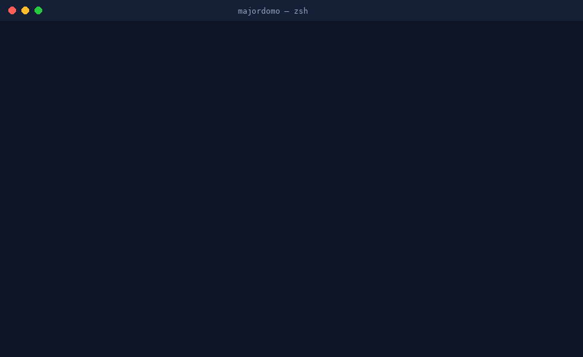

<p align="center">
  
</p>

<h1 align="center">Majordomo</h1>

<p align="center">
  <strong>Your self-hosted personal AI agent — lives on your machine, remembers what matters, and gets the work done.</strong>
</p>
<p align="center">
  
</p>
<p align="center">
  
  <br>
  <em>Domo at work — a real run on the built-in offline demo data: he checks mail, files a fact by himself, recalls it in a brand-new session, notices new mail on his own, and prints his brief.</em>
</p>


<p align="center">
  <a href="https://github.com/EdgeAgent/majordomo/actions/workflows/ci.yml"></a>
  <a href="https://www.python.org/"></a>
  
  
  <a href="LICENSE"></a>
</p>

**Majordomo is a personal AI agent for one person: you.** It runs on your own machine — a laptop, a home server, a spare box in the corner — and it works like a good majordomo should: it remembers your preferences, keeps your schedule, does the research, drafts the documents, and asks before it does anything that matters. No account, no subscription, no cloud holding your data. Your conversations, your memory, and your files live in one folder on your disk, in formats you can open with any text editor.

It talks to **whatever model you give it a key for** — Anthropic, OpenAI, DeepSeek, Gemini, OpenRouter, Groq, Mistral, xAI, or Together — or to a **local model** (Ollama) when you'd rather nothing leave the machine, and — the party trick — it can **consume MCP servers** — any server that speaks the protocol plugs straight into it.

## Why self-hosted?

The hosted personal agents are genuinely impressive, and they all share one property: *your life runs through somebody else's computer.* Your preferences, your half-finished thoughts, your 2 a.m. questions — logged on a server you don't control, under terms that can change.

Majordomo takes the other side of that trade:

- **Your memory is a folder of Markdown files.** Read it, edit it, back it up, delete it. If Majordomo remembers something wrong, you can fix it with a text editor — try that with a cloud profile.
- **Your model can be local.** With Ollama, nothing leaves the machine at all. When you do use a hosted model, that's your key and your choice, per install.
- **Your tools ask first.** Anything that writes, creates, schedules, or generates goes through an approval gate. Looking is free; acting is permitted.
- **It stops when you stop it.** One process, one folder. `docker compose down` and the butler is off duty.

## What you can do

- **Chat** in the terminal or in a small web UI that works on your phone — ask questions, give jobs, get answers with the tool calls shown, not hidden.
- **Be remembered, explicitly.** Say "remember that my favourite coffee is a double espresso" and it's a line in a file you own. Ask next week, in a *different* conversation, and Majordomo recalls it. Nothing is captured silently — memory is written only through the remember tool or the `memory` CLI, unless you opt in to self-filing (below).
- **Research the web**: search plus readable page fetches, with failures reported as failures — never invented content.
- **Get documents made**: Word briefs, PowerPoint decks, and Excel sheets, created and read back inside a sandboxed workspace the agent cannot escape.
- **Set reminders** — one-time or daily/weekly — that fire into your chat inbox on schedule.
- **Generate images** through a pluggable backend (a placeholder backend ships; live generation uses your own provider key).
- **Work your inbox** — list, read, and search email, save drafts into the workspace, and send (sending is an acting tool: it asks first). Standard-library IMAP/SMTP behind the `MAJORDOMO_MAIL_*` settings; offline runs get a seeded fake mailbox, and an unconfigured live run says so instead of pretending.
- **Run always-on** — `majordomo daemon` ticks the scheduler forever, firing due reminders into your inbox session with no window open. Service files for systemd and Windows Task Scheduler ship in `deploy/` (see `docs/always-on.md`).
- **File its own facts — only if you opt in.** With `MAJORDOMO_AUTO_MEMORY=true`, simple statements in your own messages ("my favourite coffee is ...", "remember ...") are filed to memory after the turn. The extractor is deliberately narrow: questions, commands, and chit-chat are never filed. Off by default.
- **Plug in MCP servers** — point Majordomo at a JSON config and every tool those servers expose joins the registry, approval gate included. The example config points Majordomo at a second Majordomo — it is an MCP server itself (`majordomo mcp-server`).

## Takes initiative

A majordomo who only answers when spoken to is a search box. While the daemon (or the web app) is running, Majordomo also works the room on its own — deterministically, no model required, and read-only: it never sends mail and never touches an acting tool on its own initiative.

- **Mail watch.** Every tick polls the mailbox. A message that has never been seen before lands in your inbox session as a one-line digest — `📬 New mail from Ada Lovelace: Notes on the Analytical Engine`. The first tick only sets the baseline, so the mail already sitting there isn't "news".
- **Escalation.** A reminder that fired more than two hours ago and is still unacknowledged is surfaced once more — `⏰ Still waiting: ...` — and never again. (Acknowledged, precisely: the reminder left the schedule store because you cancelled or cleared it. Firing alone doesn't count as you having seen it.)
- **The morning brief.** `majordomo brief` assembles today from real state — active reminders with overdue ones called out, how much mail is new plus the latest subjects, and your most recent memory entries — prints it, and saves it to the workspace as `brief-YYYY-MM-DD.md`. No LLM: a template over the same stores, so it works fully offline.

The engine's memory is one small JSON file (`initiative.json` in the data directory): seen mail ids and the reminders it watched fire. Delete it and the next tick simply re-baselines.

## Feature map

| Capability | How it works | Needs |
| --- | --- | --- |
| Chat agent loop | Provider protocol with tool calling; sessions persisted per conversation | Any provider key, or local Ollama |
| Long-term memory | `facts.md` / `preferences.md` / `notes.md` — plain files, explicit writes only | Nothing |
| Cross-session recall | Token search over past conversation files | Nothing |
| Web search + fetch | Injectable backends; live = DuckDuckGo HTML + httpx, tests/demo = fakes | Network for live use |
| Workspace files | List/read/write inside one sandboxed directory; escapes refused and tested | Nothing |
| Office documents | Create + read `.docx` / `.pptx` / `.xlsx` | The `documents` extra |
| Image generation | Backend protocol; fake PNG backend ships, OpenAI-compatible backend included | Your key for live images |
| Reminders | JSON store; `schedule run-due` CLI + the web app's background tick | Nothing |
| Mail | IMAP/SMTP tools (stdlib only) behind a backend protocol; fake mailbox offline, honest "not configured" otherwise | Your mail account for live use |
| Always-on daemon | `majordomo daemon` ticks the scheduler; systemd + Task Scheduler files in `deploy/` | Nothing |
| Initiative | Mail watch digests + one-time escalation of unacknowledged reminders, per tick; state in `initiative.json` | A running daemon or web app |
| Morning brief | `majordomo brief` — reminders, new mail, recent memory, templated from real state | Nothing |
| Self-filing memory | Opt-in (`MAJORDOMO_AUTO_MEMORY`); a narrow extractor files stated facts after a turn | Nothing |
| MCP client | stdio JSON-RPC client; remote tools namespaced `<server>__<tool>`, `readOnlyHint` honoured | Any MCP server |
| Web UI + API | FastAPI, one self-contained page, `/chat` `/sessions` `/memory` `/health` | Nothing |
| Phone access | The same web UI over Tailscale Serve (below) | Tailscale on both devices |

## Quick start

### Docker (the front door)

```bash
git clone https://github.com/EdgeAgent/majordomo.git
cd majordomo
docker compose up --build
```

Open [http://127.0.0.1:8080](http://127.0.0.1:8080). The compose file expects a local Ollama on your host (it reaches it via `host.docker.internal`); pull a model first with `ollama pull llama3.1`. All state persists in the `majordomo-data` volume. To use a hosted model instead, set `MAJORDOMO_PROVIDER=openai` and `MAJORDOMO_OPENAI_API_KEY` in the compose environment.

### pip (the side door)

```bash
git clone https://github.com/EdgeAgent/majordomo.git
cd majordomo
python -m pip install -e ".[documents]"
majordomo serve            # web UI + API on http://127.0.0.1:8080
majordomo chat             # or just talk in the terminal
```

No model handy yet? Run the whole thing on the built-in fake provider — no server, no key:

```bash
MAJORDOMO_PROVIDER=fake majordomo demo
```

The demo walks a scripted day — research, a Word brief, a fired reminder, a memory recalled in a new session — and prints the transcript. `python scripts/demo.py` does the same with no install at all.

## Phone via Tailscale

The web UI is one responsive page, so your phone needs no app — it needs a private road to your machine. Tailscale is that road:

1. Install [Tailscale](https://tailscale.com/download) on the computer running Majordomo and on your phone; sign both into the same tailnet.
2. Start Majordomo (`docker compose up` or `majordomo serve`).
3. On the computer, expose it to your tailnet only:

   ```bash
   tailscale serve --bg --http=8081 http://127.0.0.1:8080
   ```

4. Open the URL Tailscale prints (something like `http://your-machine.your-tailnet.ts.net:8081`) in the phone's browser.

Traffic stays inside your encrypted tailnet — nothing is published to the public internet, and there are no certificates to manage. Tick **approve actions** in the page when you want Majordomo to act on a request from the couch; leave it unticked and it can look, but not touch.

## The tools, and the gate

| Tool | Does | Class |
| --- | --- | --- |
| `web_search`, `web_fetch` | Search the web; fetch a page as readable text | Read-only |
| `memory_recall`, `search_past_chats` | Search memory files; search past conversations | Read-only |
| `workspace_list`, `workspace_read`, `read_document` | Look inside the workspace; read Office files | Read-only |
| `list_reminders` | Show active reminders | Read-only |
| `mail_list`, `mail_read`, `mail_search` | List, read, and search the inbox | Read-only |
| `memory_remember` | Write one entry to long-term memory | **Acting** |
| `mail_draft`, `mail_send` | Save an email draft in the workspace; send an email | **Acting** |
| `workspace_write` | Write a file in the workspace | **Acting** |
| `create_word_doc`, `create_powerpoint`, `create_spreadsheet` | Create Office documents | **Acting** |
| `generate_image` | Generate an image into the workspace | **Acting** |
| `schedule_reminder`, `cancel_reminder` | Set or cancel reminders | **Acting** |
| `<server>__<tool>` (MCP) | Whatever the connected server offers | Follows its `readOnlyHint` |

**Acting** tools run only when the run approves them: the interactive CLI asks per call, the web API takes an `approve` flag per message, and the demo auto-approves because every backend behind it is a fake. A declined call is reported to the model as declined — the agent never quietly retries its way around you.

## Memory, in the open

Memory lives in `<data dir>/memory/` as three Markdown files — `facts.md`, `preferences.md`, `notes.md` — one bullet per entry:

```markdown
# Majordomo memory — preferences

- my favourite coffee is a double espresso
```

Inspect and edit it from the CLI:

```bash
majordomo memory list
majordomo memory add fact "The workshop is in London, Ontario"
majordomo memory search coffee
majordomo memory forget preference:1
```

Automatic capture is **off** by default, by design. The write paths are the `memory_remember` tool (approval-gated) and the commands above. One opt-in exists: set `MAJORDOMO_AUTO_MEMORY=true` and a deliberately narrow extractor files simple statements from your own messages after each turn — explicit "remember ..." statements and "my <thing> is <value>" declarations, filed as facts. Questions, commands, and chit-chat are never filed, and a fact already in memory is not filed twice. If it isn't in the files, Majordomo doesn't remember it.

## MCP: plug in any server

Majordomo works both sides of MCP. As a *client*, give it a config file (see [`examples/mcp-servers.json`](examples/mcp-servers.json)):

```json
{
  "servers": {
    "majordomo": { "command": "majordomo", "args": ["mcp-server"] }
  }
}
```

```bash
MAJORDOMO_MCP_CONFIG=examples/mcp-servers.json majordomo chat
```

Majordomo launches each server over stdio, does the initialize handshake, and registers its tools as `majordomo__workspace_list` and friends. A server tool annotated `readOnlyHint` runs free; anything else passes the same approval gate as a built-in acting tool. If it speaks MCP, it plugs in.

And as a *server*: `majordomo mcp-server` serves Majordomo's own tools over stdio to any MCP client — another agent can search this one's memory, read its workspace, and use its web tools. The gate holds on this side too: only read-only tools are served unless the operator starts it with `--allow-write`. The example config above points one Majordomo at another; the server side never loads an MCP config itself, so the loop cannot recurse.

## What runs where

One process does everything; the **data directory** (default `~/.majordomo`, or `/data` in Docker) holds the whole life of the agent:

```text
~/.majordomo/
├── memory/          facts.md · preferences.md · notes.md   (yours to edit)
├── sessions/        one JSON file per conversation         (recall searches these)
├── schedules.json   reminders
├── initiative.json  initiative state: seen mail ids, fired reminders
└── workspace/       the only folder the file/document tools may touch
    └── images/      generated images land here
```

The **provider** is the only piece that may leave the machine: Ollama stays local; a hosted provider sends your prompts to that provider's endpoint, with your key. Web search/fetch reach the network only when you ask a question that needs them. Architecture details live in [`docs/architecture.md`](docs/architecture.md); adding tools, providers, and MCP servers is covered in [`docs/extending.md`](docs/extending.md).

## Bring your own key

Majordomo is not married to one model company. Give it a key for **any** major provider and it uses that provider's model — just set the one variable:

| Provider | Get a key at | Variable | Default model |
| --- | --- | --- | --- |
| Anthropic | console.anthropic.com | `MAJORDOMO_ANTHROPIC_API_KEY` | `claude-sonnet-4-5` |
| OpenAI | platform.openai.com | `MAJORDOMO_OPENAI_API_KEY` | `gpt-4o` |
| DeepSeek | platform.deepseek.com | `MAJORDOMO_DEEPSEEK_API_KEY` | `deepseek-chat` |
| Gemini | Google AI Studio (aistudio.google.com) | `MAJORDOMO_GEMINI_API_KEY` | `gemini-2.5-flash` |
| OpenRouter | openrouter.ai | `MAJORDOMO_OPENROUTER_API_KEY` | `openai/gpt-4o` |
| Groq | console.groq.com | `MAJORDOMO_GROQ_API_KEY` | `llama-3.3-70b-versatile` |
| Mistral | console.mistral.ai | `MAJORDOMO_MISTRAL_API_KEY` | `mistral-large-latest` |
| xAI | console.x.ai | `MAJORDOMO_XAI_API_KEY` | `grok-4` |
| Together | api.together.ai | `MAJORDOMO_TOGETHER_API_KEY` | `meta-llama/Llama-3.3-70B-Instruct-Turbo` |
| Ollama | ollama.com — runs locally, no key | — | `llama3.1` |
| Fake | built in — the offline demo provider | — | (scripted) |

**Auto-detect is the default** (`MAJORDOMO_PROVIDER=auto`): the first key that is set wins, in the table's order — Anthropic, OpenAI, DeepSeek, Gemini, OpenRouter, Groq, Mistral, xAI, Together. With no key set, a configured local Ollama is used; with neither, Majordomo runs on the fake provider and says so. Pin one provider with `MAJORDOMO_PROVIDER=deepseek` (any table name), and override any default model with `MAJORDOMO_MODEL` (e.g. `MAJORDOMO_MODEL=claude-opus-4-5`).

Run `majordomo providers` to see every provider, the variable that feeds it, and which one is active under your current settings. Keys are never printed or logged — the listing shows only "key set" / "no key", and it is your key and your bill with whichever provider you choose.

Under the hood there are two adapters: one parameterized OpenAI-compatible adapter serves every compatible endpoint (OpenAI, DeepSeek, Gemini, OpenRouter, Groq, Mistral, xAI, Together), and a native adapter speaks Anthropic's Messages API, whose wire shape genuinely differs.

## Configuration

Everything is an environment variable (or a `.env` file) — see [`.env.example`](.env.example) for the full list. The ones that matter:

| Variable | Default | Meaning |
| --- | --- | --- |
| `MAJORDOMO_DATA_DIR` | `~/.majordomo` | Where memory, sessions, schedules, and the workspace live |
| `MAJORDOMO_PROVIDER` | `auto` | `auto`, or any provider name from the table above, or `ollama` / `fake` |
| `MAJORDOMO_MODEL` | per provider | Overrides the active provider's default model |
| `MAJORDOMO_OLLAMA_BASE_URL` / `MAJORDOMO_OLLAMA_MODEL` | `http://localhost:11434` / `llama3.1` | Local model endpoint and model |
| `MAJORDOMO_*_API_KEY` | — | One per hosted provider — see [Bring your own key](#bring-your-own-key). (`MAJORDOMO_OPENAI_API_KEY` also feeds live images.) |
| `MAJORDOMO_IMAGE_BACKEND` | `fake` | `fake` (placeholder PNG) or `openai` |
| `MAJORDOMO_MCP_CONFIG` | — | Path to an MCP servers JSON file |
| `MAJORDOMO_HOST` / `MAJORDOMO_PORT` | `127.0.0.1` / `8080` | Web app bind |

## Develop and test

```bash
python -m pip install -e ".[dev,documents]"
ruff check .
ruff format --check .
pytest
```

The suite runs entirely on fakes — the fake provider, canned web pages, a fake clock for the scheduler, a placeholder image backend, and a tiny in-repo MCP server fixture — so it needs no network, no keys, and no running model. It covers the approval gate (a declined acting tool *provably* does nothing), memory recall across sessions, sandbox escape attempts, real `.docx`/`.pptx` files created and reopened, and the MCP client speaking the protocol to the fixture server. GitHub Actions runs the same checks on Python 3.11, 3.12, and 3.13.

## What this does — and does not do

Majordomo is a **single-user** agent by design: no accounts, no multi-tenancy, no permission system beyond the approval gate. Run one per person, on their machine.

There is **no browser automation in v1** — no Chromium form-driving, no clicking through websites. Web research is search + readable fetch, and anything richer belongs in an MCP server you connect (that's what the protocol is for). Image generation ships with a placeholder backend; live images need your own provider key and run on your bill. The fake provider is a demo and testing tool — it pattern-matches obvious requests (now including mail checks, briefs, and look-up-and-save research) and answers the rest with a canned line that says what it is. Real conversation needs Ollama or an API key. The initiative engine and the brief are not the fake provider: they are deterministic code over real state, and they work the same with any provider.

Memory recall is honest token search over your files, not embeddings: it finds what shares words with your question, and it returns nothing rather than guessing. The scheduler fires while a Majordomo listener is running: the web app ticks every 30 seconds, `majordomo daemon` ticks forever on its own, and the shipped systemd / Task Scheduler files (see `docs/always-on.md`) make that listener a real always-on service. And the approval gate is a seatbelt, not a vault: it stops the agent from acting unapproved, but the workspace sandbox and your own backups are what protect your files.

## Repository layout

```text
.
├── .github/workflows/ci.yml    # Python matrix tests and package build
├── assets/                     # Icon and banner (JPG) + social preview (SVG)
├── docs/                       # Architecture, the extending guide, always-on setup
├── deploy/                     # systemd unit + Windows Task Scheduler installer
├── examples/                   # Example MCP server config
├── scripts/demo.py             # Standalone demo, no install needed
├── src/majordomo/
│   ├── config.py               # MAJORDOMO_* settings
│   ├── providers.py            # Provider presets: Anthropic, OpenAI, DeepSeek, Gemini, OpenRouter, Groq, Mistral, xAI, Together, Ollama, fake
│   ├── agent.py                # The chat loop + approval gate
│   ├── tools.py                # The tool registry
│   ├── coretools.py            # Memory + recall tools
│   ├── memory.py               # Long-term memory as Markdown files
│   ├── sessions.py             # Persisted conversations + cross-session search
│   ├── filetools.py            # The sandboxed workspace
│   ├── webtools.py             # Search + fetch behind injectable backends
│   ├── mailtools.py            # Mail behind injectable backends (IMAP/SMTP, fake)
│   ├── autocapture.py          # Opt-in self-filing memory extractor
│   ├── doctoolkit.py           # Word / PowerPoint / Excel (documents extra)
│   ├── imagetools.py           # Image backends: fake + OpenAI-compatible
│   ├── scheduler.py            # Reminders and the firing engine
│   ├── initiative.py           # Mail watch + escalation, run per tick
│   ├── brief.py                # The deterministic morning brief
│   ├── mcp_client.py           # stdio MCP client
│   ├── runtime.py              # Wiring: settings in, agent out
│   ├── webapp.py               # FastAPI app + the single-page chat UI
│   ├── cli.py                  # The majordomo CLI
│   └── demo.py                 # The scripted demo day
├── tests/                      # Fakes-first tests for all of it
├── Dockerfile / compose.yaml   # One service, one volume, port 8080
├── PUBLISHING.md               # Repo description + topics for publish time
└── pyproject.toml              # Package metadata and install profiles
```

## Contributing

Install the development profile, run the checks above, and keep the default install lean. New tools and providers follow [`docs/extending.md`](docs/extending.md): one job per tool, backends behind protocols, truthful read-only/acting classification, tests on fakes. See [`CONTRIBUTING.md`](CONTRIBUTING.md).

## The series, and the license

Majordomo stands on the Edge Agency AI Automation series: [Step 1 — the starter kit](https://github.com/EdgeAgent/ai-automation-starter) · [Step 2 — agent recipes](https://github.com/EdgeAgent/ai-automation-agents). This repository is not published to PyPI; clone it and use the editable install commands above. Released under the [MIT License](LICENSE). Publishing notes (description, topics, social preview) live in [`PUBLISHING.md`](PUBLISHING.md).
